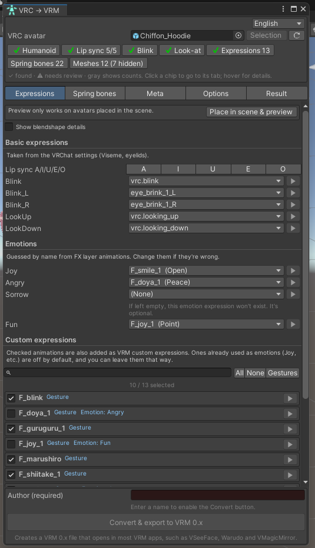
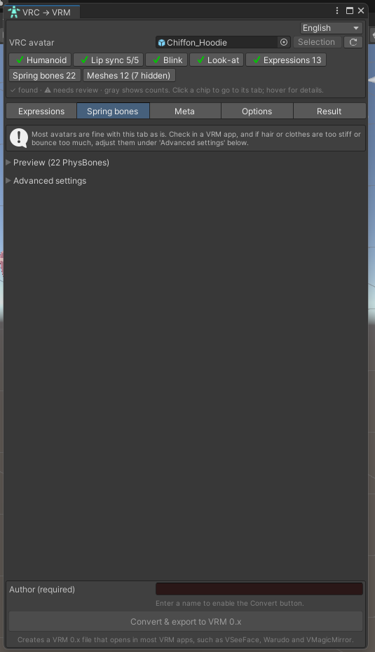
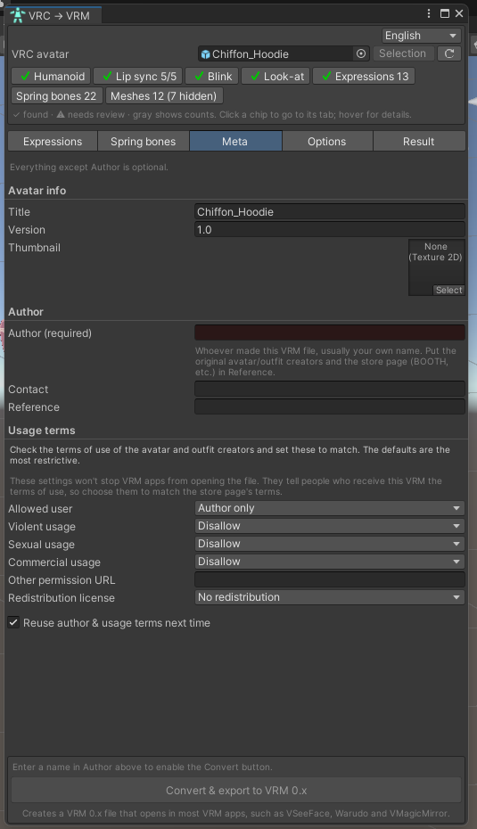
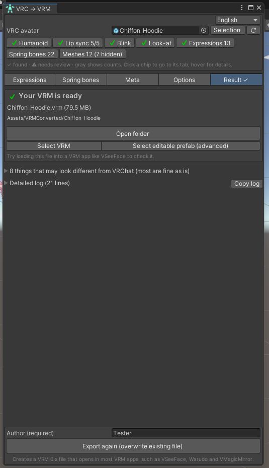

# VRC → VRM Converter

A Unity editor tool that turns a VRChat avatar into a VRM 0.x file you can load in VSeeFace, Warudo, VMagicMirror and other VRM apps.

You pick the avatar you already upload to VRChat, outfit and all, and press one button. The tool reads the VRChat setup (lilToon materials, PhysBones, the avatar descriptor and the FX layer) and builds the VRM versions of them. Nothing in your project is modified; the output goes to its own folder.

UI languages: English, 한국어, 日本語, 简体中文.

> **Check your avatar's terms first.** Many BOOTH avatars and outfits have their own rules about converting to VRM or using the model outside VRChat. This tool can't check that for you.



## What gets converted

| In VRChat | In the VRM |
|---|---|
| lilToon materials | MToon materials |
| PhysBones and PhysBone colliders | Spring bones and sphere colliders (a capsule becomes a row of spheres) |
| Viseme blendshapes, or lip sync driven by the FX layer | A / I / U / E / O |
| Eyelid blendshapes, eye bones | Blink, Blink_L / Blink_R, LookUp / LookDown, bone look-at |
| Hand-gesture and toggle animations in the FX layer | Joy / Angry / Sorrow / Fun (guessed from names; you can change them) and custom expressions |
| View position | First-person offset |
| Objects you've switched off, like a spare outfit | Left out, so the VRM looks like the avatar does right now |

The material conversion uses the same parameter mapping as lilToon's own "Convert to MToon". Things MToon can't do on its own, like lilToon's 2nd/3rd texture layers, color adjustments, shadow masks and alpha masks, get baked into new textures.

Not converted:

- Shaders other than lilToon. Those get a basic MToon with just the main texture.
- Modular Avatar and VRCFury setups, because those tools only merge the outfit when you upload. Bake the avatar first and convert the baked copy. For Modular Avatar, right-click the avatar and choose **Modular Avatar › Manual bake avatar**.
- Face-tracking blendshapes (ARKit / "perfect sync"). Only the VRM presets above and your custom expressions are set up.
- The Gesture layer's hand poses. The finger bones are in the VRM, but posing them is up to your VRM app.
- Constraints, contacts, particles, and anything else VRM 0.x has no place for.

VRM 0.x only for now, since that's what most apps open. 1.0 isn't supported yet.

## Requirements

- Unity 2022.3 (the version VRChat uses)
- VRChat SDK, Avatars 3.x
- lilToon 2.x. The tool uses lilToon's editor code to bake textures, so it has to be in the project.
- UniVRM 0.x, i.e. the packages `com.vrmc.gltf` and `com.vrmc.univrm`

Tested with Unity 2022.3.22f1, VRChat SDK 3.10.5, lilToon 2.3.4 and UniVRM 0.131.2.

## Install

1. **UniVRM.** On the [UniVRM releases page](https://github.com/vrm-c/UniVRM/releases) download **`UniVRM-<version>.unitypackage`** and drag it into your project. That's the VRM 0.x package. The similarly named `VRM-<version>.unitypackage` is for VRM 1.0 and isn't the one this tool uses. If you'd rather use the Package Manager, add these two git URLs (Window › Package Manager › + › Add package from git URL):
   ```
   https://github.com/vrm-c/UniVRM.git?path=/Packages/UniGLTF#v0.131.2
   https://github.com/vrm-c/UniVRM.git?path=/Packages/VRM#v0.131.2
   ```
2. **This tool.** Click **Code › Download ZIP** on [this page](https://github.com/ouor/vrc-to-vrm), unzip it, and drag the folder into your project's `Assets` folder (rename it to `VrcToVrm` if you like). With git:
   ```bash
   git clone https://github.com/ouor/vrc-to-vrm.git Assets/VrcToVrm
   ```

lilToon and the VRChat SDK are already in a normal VRChat avatar project.

### Is it safe for my VRChat project?

The tool doesn't add anything to your avatar or change its materials. It works on a copy and only writes into its output folder. Exporting through UniVRM switches the textures it reads to "Uncompressed", and the tool sets them back right after, so your VRChat upload size stays the same.

UniVRM is a regular editor package. Avatars without VRM components upload to VRChat as usual. To remove the tool later, delete its folder. Remove UniVRM too if you only added it for this.

## Usage

1. Open **Tools › VRC → VRM › Converter**, or right-click an avatar in the Hierarchy or Project window and choose **VRC → VRM…**.
2. Put your avatar (a prefab or an object in the scene) into the **VRC avatar** field. The chips under it show what was found: lip sync, blink, look-at, expressions, spring bones, meshes. Click one to jump to its tab.
3. Type your name into **Author** at the bottom. It's the only required field.
4. Press **Convert & export to VRM 0.x**.

You usually don't need the tabs, but:

- **Expressions**: which blendshapes and FX animations become which VRM expression. Place the avatar in the scene and you can preview each one with ▶.
- **Spring bones**: what each PhysBone turns into, and the conversion coefficients under *Advanced settings*.
- **Meta**: title, author and the usage terms stored in the VRM. Set them to match the terms of the avatar and outfit you bought.
- **Options**: output folder, T-pose, removing hidden objects, texture baking, and whether to keep MatCap shine (see Known limitations).

<p>



</p>

When it's done, the Result tab shows the file and its size and an **Open folder** button. Below that is a collapsed list of things that will look different from VRChat, like "outline may look slightly different". Load the file in your VRM app and see how it looks.

### Converting several avatars

Select prefabs or folders in the Project window and run **Tools › VRC → VRM › Batch Convert Selected**. Every avatar is converted with the default guesses, and a report goes to `Logs/VrcToVrm_report.txt`.

## Output

For an avatar called `Chiffon_Hoodie` with the default output folder:

```
Assets/VRMConverted/Chiffon_Hoodie/
  Chiffon_Hoodie.vrm            the file to load in your VRM app
  Chiffon_Hoodie_Setup.prefab   the converted avatar before export
  Meta.asset
  Materials/                    *_mtoon.mat
  Textures/                     baked textures
  BlendShapes/                  VRM expression clips
  .vrctovrm                     marks the folder as tool output
```

If you want to fix something by hand, edit `*_Setup.prefab` and export it again with UniVRM's **VRM0 › Export VRM 0.x...**.

Since the `.vrm` is saved inside `Assets`, UniVRM imports it as well and you'll see a `Chiffon_Hoodie.prefab` and some `Chiffon_Hoodie.*` folders next to it. That's just UniVRM; you can ignore or delete them.

Converting the same avatar again replaces its folder (the old one goes to the trash). Only folders with the `.vrctovrm` marker are ever replaced, so a mistyped output path can't wipe your own assets.

## Tested avatars

These all convert with the default settings, and the files load in UniVRM and in [three-vrm](https://github.com/pixiv/three-vrm):

ASH, Chiffon, Eku, Karin, Kinako (PC and Quest), Kipfel (PC and Mobile), Lumia, Lurie, Phi, Rainy, Telmy and Tenchill, plus a few outfit swaps (ArtemisSailor on Karin, a hoodie and ITACHIHOLIC on Chiffon).

I've only checked them in UniVRM and three-vrm, not in every VRM app. If something looks off in yours, please open an issue.

## Known limitations

- VRM 0.x has no PhysBone angle limits, curves or stretch, so some parts may swing more than in VRChat. For PhysBones that have angle limits, arm colliders are skipped by default so that raising an arm doesn't lift the hair along with it (Spring bones › Advanced settings).
- MToon can't mask a matcap. A matcap that lilToon only applies to part of a material is dropped unless it covers most of it, in which case it's spread over the whole material at its average strength.
- MToon draws matcap shine without lighting, so shiny parts (often hair) stay bright in dark scenes. If you'll use the avatar somewhere dark, turn off **Keep MatCap shine** in Options.
- Lighting works a bit differently in MToon:
  - Shadows cast by other parts (a hat brim on the hair, hair on the face) always show, even where lilToon was set not to receive them.
  - Extra point and spot lights are weaker than in lilToon.
  - lilToon keeps a minimum brightness in very dark worlds, while MToon lets the avatar go dark.
  - Rim light can't be limited to the lit side, so it's spread evenly at a lower strength.
- Glow (emission) that uses a second UV map, such as scrolling light strips, is left out. AudioLink glow stays at a fixed brightness.
- Textures keep their full resolution, so avatars with lots of 4K textures end up large (60–80 MB isn't unusual). There's no option to shrink them yet.
- Emotions are guessed from clip and blendshape names (`smile`, `angry`, `sad`, their Japanese equivalents and so on). If your avatar names its faces differently, pick them in the Expressions tab before exporting.

## Troubleshooting

- **The Convert button is greyed out.** Something it needs is missing. Usually it's the Author field. Otherwise the message above the button says what: no Humanoid avatar on the root Animator, or an output folder outside `Assets`.
- **A chip has a ⚠.** Hover over it to see what wasn't found. Blink and expressions can be picked by hand in the Expressions tab.
- **Pink materials in the VRM or the Setup prefab.** The MToon shader comes with UniVRM. Check that the UniVRM 0.x package is installed (see Install).
- **Hair or clothes are too stiff or too floppy in the VRM app.** Adjust the coefficients in Spring bones › Advanced settings and convert again.

## Support

Open an issue on this repository. Include the Unity, VRChat SDK, lilToon and UniVRM versions, and paste the log from the Result tab (**Copy log**).

## Development

Everything is in `Editor/`. The pipeline is in `VrcToVrmConverter.cs` and runs on a copy of the avatar. `VrcAvatarAnalysis.cs` reads the descriptor and FX layer, `PhysBoneToSpringBone.cs` and `LilToonToMToon.cs` do the two big conversions, and `VrcToVrmWindow.cs` is the UI.

<details>
<summary>A few details that aren't obvious from the code layout</summary>

- PhysBone `pull` and `stiffness` become spring stiffness, `spring` and `immobile` become drag, and `gravity` carries over. The coefficients are exposed in the Spring bones tab. VRM 0.x has no ignore list, so chains with ignored bones or nested PhysBones are split into separate roots.
- UniVRM's exporter switches every texture it exports to "Uncompressed" and reimports it. The tool records your compression settings before exporting and puts them back afterwards.
- FakeShadow passes and meshes with no material are removed before export. They render nothing useful in MToon, and empty meshes can also break UniVRM's importer.

</details>

### Translations

All UI text is in `Localization~/strings.json` (`en`, `ko`, `ja`, `zh`). After editing it, regenerate the C# table:

```bash
python Localization~/gen_table.py
```

The script stops if a translation's `{0}`-style placeholders don't match the English text.

## License

[MIT](LICENSE). This covers the tool only. The avatars you convert keep their own terms.
